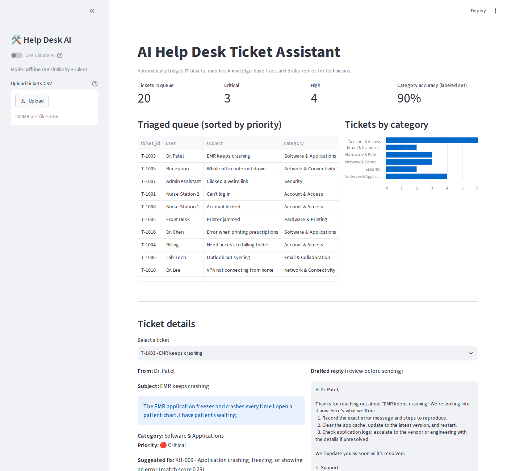

# AI Help Desk Ticket Assistant

An AI-powered tool that helps IT support teams work through their ticket queue faster. It reads incoming tickets, sorts them by **category** and **priority**, suggests a fix from the **knowledge base**, and **drafts a reply** for the technician to review.



## Why I built this

Working as a Level 2 IT Support Specialist, I saw how much time goes into reading every ticket, deciding how urgent it is, and looking up the same fixes again and again. This assistant handles that first pass so technicians can spend their time actually solving problems, starting with the most urgent ones.

## Features

- **Automatic triage:** classifies each ticket into one of 6 categories and 4 priority levels
- **Knowledge-base matching:** finds the most relevant fix article using TF-IDF text similarity
- **Drafted replies:** writes a friendly, plain-language reply for the user
- **Priority queue dashboard:** sorts the queue so critical issues (outages, security incidents, blocked patient care) come first
- **Two modes:**
  - **AI mode** uses Claude (Anthropic API) for classification and reply writing
  - **Offline mode** uses KB similarity + keyword rules, so it runs with no API key
- **Built-in evaluation:** measures accuracy against a labeled set of tickets

## Results (offline mode, 20 labeled sample tickets)

| Metric | Result |
|---|---|
| Category accuracy | 90% |
| Priority accuracy | 85% |
| Time to triage 20 tickets | < 0.1 seconds |

Run `python evaluate.py --ai` with an API key to compare AI mode.

## Tech stack

Python · Streamlit · scikit-learn (TF-IDF, cosine similarity) · pandas · Anthropic Claude API

## How to run

```bash
pip install -r requirements.txt

# Offline mode (no API key needed)
streamlit run app.py

# AI mode
export ANTHROPIC_API_KEY=your_key_here      # Windows: set ANTHROPIC_API_KEY=your_key_here
streamlit run app.py

# Accuracy check
python evaluate.py
python evaluate.py --ai
```

You can upload your own tickets as a CSV with columns: `ticket_id, user, subject, description`.

## Project structure

```
app.py                     Streamlit dashboard
triage.py                  Triage logic (KB search, classification, reply drafting)
evaluate.py                Accuracy evaluation on labeled tickets
data/knowledge_base.json   12 IT knowledge-base articles
data/sample_tickets.csv    20 sample tickets with correct labels
```

## Next steps

- Connect to a real ticketing system (e.g. Zendesk or ServiceNow API)
- Let technicians rate suggestions to improve matching over time
- Expand the knowledge base and labeled test set
